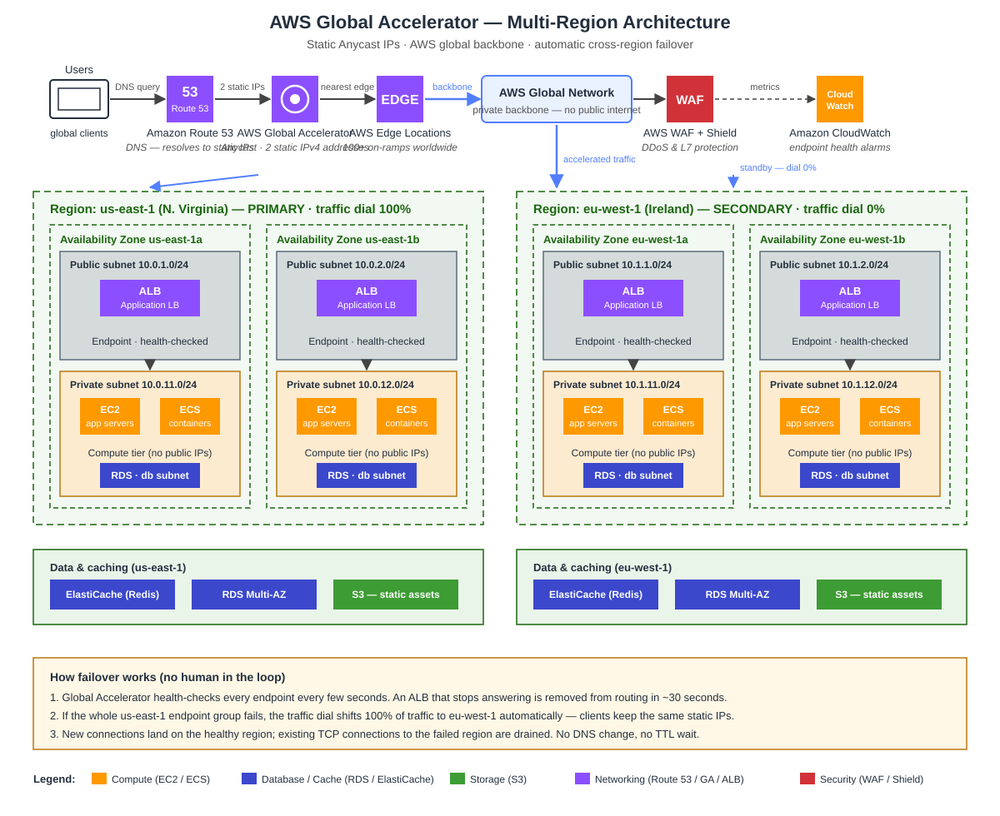

# AWS Global Accelerator — One Fixed IP for the Whole Planet

[](https://aws.amazon.com/global-accelerator/)
[](https://aws.amazon.com/global-accelerator/)
[](LICENSE)
[](#)

> **TL;DR:** AWS Global Accelerator gives your application **two static Anycast IP addresses** that never change, and routes each user over the AWS global network to the healthiest, closest endpoint. DNS still resolves your name — but the traffic rides AWS's private backbone from the nearest edge location instead of the public internet, cutting latency and surviving regional failures automatically.

---

## What Global Accelerator actually gives you

| Piece | What it does | Why it matters |
|---|---|---|
| **Static Anycast IPs (2)** | Two fixed IPv4 addresses announced from every AWS edge location | Your clients whitelist one IP pair forever — no DNS propagation delay when you fail over |
| **Accelerator** | The top-level resource (Standard or Custom Routing) | One accelerator fronts all your endpoints, in every region |
| **Listeners** | Port + protocol (TCP/UDP) on the accelerator | A listener maps e.g. TCP 443 to your endpoint groups |
| **Endpoint groups** | One per region, with a traffic dial (0–100%) | Shift traffic between regions gradually, or drain one to zero |
| **Endpoints** | ALB, NLB, EC2 instance, or Elastic IP | The real backends; can live in multiple regions |
| **Health checks** | Continuous checks against every endpoint | Unhealthy endpoints are removed from routing in ~30 seconds |

The mental model: **Global Accelerator is a private highway on-ramp.** Normal internet traffic takes whatever public path BGP happens to choose. With Global Accelerator, a user connects to the nearest AWS edge location and then travels on AWS's own backbone all the way to your region — the congested public internet is skipped for most of the journey.

---

## Architecture



Traffic flow: **User → Route 53 → Global Accelerator (static Anycast IPs) → nearest AWS edge location → AWS global backbone → ALB (us-east-1 / eu-west-1) → EC2 / ECS → RDS / ElastiCache**, with **CloudWatch** alarms on endpoint health and **WAF + Shield Advanced** in front of the load balancers.

Key design decisions in the diagram:

- **Two regions, one accelerator** — endpoint groups in `us-east-1` and `eu-west-1`; the traffic dial sends 100% to the healthy region and 0% to a region under maintenance.
- **Static IPs never change** — clients, firewalls and partners whitelist the two Anycast addresses once. Failover happens inside AWS, not in DNS, so there is no TTL wait.
- **Health checks drive routing** — Global Accelerator continuously health-checks every endpoint and drops unhealthy ones automatically; no human has to flip anything at 3 a.m.
- **Edge locations are the on-ramp** — users connect to the nearest of 100+ edge locations, so the first hop is short and the long haul rides the AWS backbone.

---

## 🌍 In plain words — what is this, really?

Global Accelerator gives your app one fixed address that people all over the world can use to reach you quickly. Normally, internet traffic takes whatever messy public road it finds, which can be slow or congested for users far away. With Global Accelerator, a user first steps onto the nearest AWS entrance, then travels on AWS's own fast private highway straight to your app. If one of your regions goes down, traffic is quietly moved to a healthy one without changing the address. Think of it like an airport express train: instead of driving across town in traffic, you hop on at the nearest station and ride a dedicated track to your destination.

---

## Global Accelerator vs the alternatives

| Option | Fixed IPs? | Path | Failover | Best for |
|---|---|---|---|---|
| **AWS Global Accelerator** | ✅ 2 static Anycast IPs | AWS backbone from edge | ~30 s, automatic | Global apps, gaming, real-time, fixed-IP clients |
| Route 53 latency routing | ❌ DNS answers change | Public internet | DNS TTL (60 s+) | Simple multi-region DNS steering |
| CloudFront | ❌ (edge IPs rotate) | AWS edge, cached content | Origin failover | Static/dynamic content delivery, caching |
| ALB alone (single region) | ❌ (DNS name only) | Public internet | None across regions | Single-region apps |
| AWS Client VPN / Direct Connect | ✅ (private) | Private link | Manual / BGP | Private corporate connectivity, not public users |

**Rule of thumb:** if your users are global and latency or failover speed matters, Global Accelerator earns its fixed fee. If your traffic is single-region or cacheable content, Route 53 or CloudFront is cheaper.

---

## Quickstart

### 1. Create an accelerator (AWS CLI)

```bash
aws globalaccelerator create-accelerator \
  --name my-app-accelerator \
  --ip-address-type IPV4 \
  --enabled
# Note the two static IPs in the response — these are yours to keep.
```

### 2. Add a listener and endpoint groups

```bash
ACCEL_ARN=$(aws globalaccelerator list-accelerators \
  --query "Accelerators[?Name=='my-app-accelerator'].AcceleratorArn" \
  --output text)

aws globalaccelerator create-listener \
  --accelerator-arn $ACCEL_ARN \
  --protocol TCP --port-ranges FromPort=443,ToPort=443

# One endpoint group per region — point each at your ALB
aws globalaccelerator create-endpoint-group \
  --listener-arn $LISTENER_ARN \
  --endpoint-group-region us-east-1 \
  --traffic-dial-percentage 100 \
  --endpoint-configurations EndpointId=$ALB_ARN_US_EAST_1,Weight=128
```

### 3. Inspect everything with the demo script

```bash
pip install boto3
python global_accelerator_demo.py --list
python global_accelerator_demo.py --estimate --endpoints 4
```

---

## Cost — the part people forget

| Item | Price (approx.) | Notes |
|---|---|---|
| Standard accelerator | **$0.025 / hour** (~$18 / month) | Charged per accelerator, whether traffic flows or not |
| Data transfer premium | **$0.015–$0.035 / GB** | On top of normal EC2/data-transfer charges; varies by source edge |
| Health checks | Included | No extra charge |
| Custom Routing accelerator | **$0.025 / hour + $0.015 / GB** | Deterministic port mapping; no health-based routing |

**Cost trap:** the hourly fee is small, but the data-transfer premium applies to *all* traffic through the accelerator. A high-bandwidth, single-region app gains nothing and pays more — measure first with the estimator in `global_accelerator_demo.py`.

---

## Production checklist

- [ ] Endpoints in **at least two regions** — one region is not multi-region.
- [ ] Traffic dial set to **100 / 0** for active-passive, or split for active-active.
- [ ] Health check path returns **200 on a real readiness endpoint**, not just `/`.
- [ ] Client timeouts tolerate the ~30 s failover window.
- [ ] Static IPs whitelisted with partners / firewalls **once**, and documented.
- [ ] CloudWatch alarms on `HealthyEndpointCount` and `NewFlowCount` per endpoint group.
- [ ] WAF / Shield Advanced on the ALBs — the accelerator does not filter attacks itself.
- [ ] BYOIP considered if you must keep your own IP range.


---

## Further reading

- [AWS Global Accelerator docs](https://docs.aws.amazon.com/global-accelerator/latest/dg/what-is-global-accelerator.html)
- [How Global Accelerator works (routing)](https://docs.aws.amazon.com/global-accelerator/latest/dg/introduction-how-it-works.html)
- [Global Accelerator vs CloudFront](https://aws.amazon.com/global-accelerator/faqs/)
